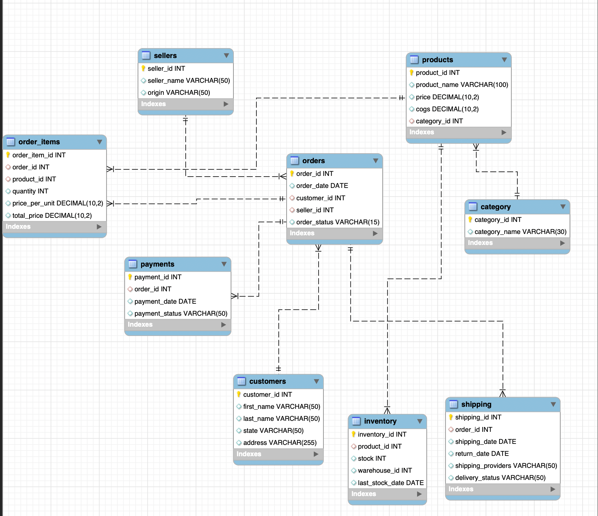

# Amazon USA Sales Analysis Project

**Difficulty Level: Advanced**

## Project Overview

I have worked on analyzing a dataset of over 20,000 sales records from an Amazon-like e-commerce platform. This project involves extensive querying of customer behavior, product performance, and sales trends using MySQL. Through this project, I have tackled various SQL problems, including revenue analysis, customer segmentation, and inventory management.

The project also focuses on data cleaning, handling null values, and solving real-world business problems using structured queries.

**Current Status:** I am currently working on this project, actively writing queries and building solutions to resolve these business problems.

## Database Schema & ERD
An ERD diagram is included to visually represent the database schema and relationships between tables. 

## Objective
The primary objective of this project is to showcase SQL proficiency through complex queries that address real-world e-commerce business challenges. The analysis covers various aspects of e-commerce operations, including:
- Customer behavior
- Sales trends
- Inventory management
- Payment and shipping analysis
- Forecasting and product performance

## Task: Data Cleaning
I cleaned the dataset by:
- **Removing duplicates**: Duplicates in the customer and order tables were identified and removed.
- **Handling missing values**: Null values in critical fields (e.g., customer address, payment status) were either filled with default values or handled using appropriate methods.

## Handling Null Values
Null values were handled based on their context:
- **Customer addresses**: Missing addresses were assigned default placeholder values.
- **Payment statuses**: Orders with null payment statuses were categorized as “Pending.”
- **Shipping information**: Null return dates were left as is, as not all shipments are returned.

## Identifying Business Problems
Key business problems identified:
- Low product availability due to inconsistent restocking.
- High return rates for specific product categories.
- Significant delays in shipments and inconsistencies in delivery times.
- High customer acquisition costs with a low customer retention rate.

## Learning Outcomes
This project enabled me to:
- Design and implement a normalized database schema.
- Clean and preprocess real-world datasets for analysis.
- Use advanced SQL techniques, including window functions, subqueries, and joins.
- Conduct in-depth business analysis using SQL.
- Optimize query performance and handle large datasets efficiently.

## Conclusion
This advanced SQL project successfully demonstrates my ability to solve real-world e-commerce problems using structured queries. From improving customer retention to optimizing inventory and logistics, the project provides valuable insights into operational challenges and solutions.

By completing this project, I have gained a deeper understanding of how SQL can be used to tackle complex data problems and drive business decision-making.
